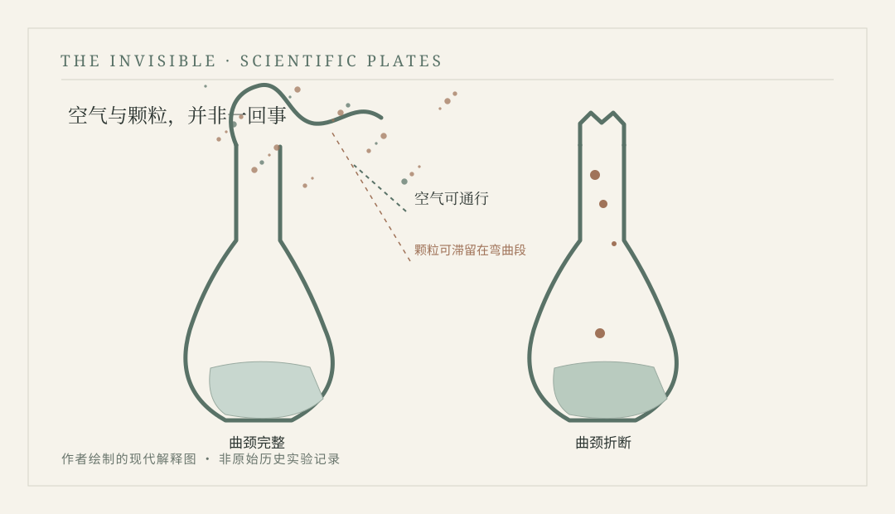

# 第十四章　鹅颈瓶 {.unnumbered}

1857—1861年，法国里尔与巴黎

<!-- 公开试读第二稿；科学史书目和细节仍在审校 -->

::: {.novel-chapter}

朱利安闻出那股酸味的时候，天还没有亮。蒸馏厂院子里的石路被雨水泡得发黑，运甜菜的马车才卸下第一车货，马夫站在棚下搓着手，抱怨今年春天迟迟不肯暖和。朱利安却没有听他讲完，便从桶沿取了一点发酵液，放到舌尖上尝了尝。液体原该带着酒精发酵的气味，如今却有一股让他牙根发紧的酸意。他把勺子放回木盆，站着想了片刻，又走到旁边一只桶前。这只桶昨天才检查过，气味尚且正常；他把盖子掀起一条缝，桶内浮着薄薄的泡沫，动静与昨夜差不多。两只桶用的是同一批甜菜，装桶的时辰也相差不远，可到了第二天清早，已经不再是同一种东西了。

厂里的人陆续来了。负责烧火的工人尚不知道出了什么事，照旧往炉膛里送煤，搬桶的少年则提着空木盆，从一道门跑向另一道门。朱利安把出问题的桶做了记号，叫他们暂时不要挪动。工人们听说又有一批原料可能报废，个个脸色不好。上个月接连两次出现这种情况，老板贝朗先生已扣住一笔本该发给工人的奖金，如今厂里欠着木桶匠和煤商的钱，再坏一批发酵液，谁也说不准下个月还能不能按时拿到工钱。

朱利安在蒸馏厂做了十二年，年轻时只会推车和洗桶，后来学会验料、记时辰，再后来，老板不在时也准他决定哪只桶可以进入下一道工序。他父亲是木桶匠，去世前常说一只桶真正好不好，不在它刚做好时有多光亮，而在于装过几回酒之后，还能不能守住该守的东西。父亲修过成千上万个桶，对木板的弯曲和铁箍的松紧了如指掌，却不懂发酵为什么有时好、有时坏。朱利安继承了父亲辨认木料的手艺，也逐渐习惯把所有问题先归在桶上：接缝漏了，便换箍；有旧气味，便多洗几遍；木头发胀，便让它晾干。可近来连新做的桶也会出问题，这使他的那套办法变得越来越不灵。

临近中午，贝朗先生从办公室出来，带着一本厚账簿，直奔发酵房。他先看被标记的桶，又问究竟坏了多少。朱利安谨慎地回答，目前还不知道整批是否全坏，但从气味和最初的检查来看，至少有几只桶不能按原定计划处理。贝朗先生合上账簿，朝墙上一张写满交货日期的纸看去，问是不是上回那个清洗桶的少年又偷懒。朱利安说没有证据，自己昨晚还检查过清洗记录。老板听后越发不高兴，责备他把时间全花在记录上，却连发酵的好坏都控制不了。

争吵是在工人面前发生的。朱利安本来还能忍，直到老板说若再这样下去，只好把几名临时雇工遣走，才忍不住反问，难道把人赶出去，那些坏酒就会自己变好吗？贝朗先生气得脸色发红，指着门让他出去冷静。朱利安站在原地没动，手里攥着记录板，板上的绳子在掌心勒出一道痕。最后还是老锅炉工马丁出来打圆场，说不如先把其他桶查完，真要算账也得有个数。老板哼了一声，回办公室去了。朱利安带着人重新干活，没人再提遣散雇工的事，可每个人都清楚，这句话迟早还会被提起。

晚上回家，他把工作服挂在门边，妻子艾莉丝正伏在桌上缝补一件童装。窗台上放着一小碗剩汤，屋里有煮过甜菜叶的气味。女儿玛蒂尔德已经十岁，正为一道算术题发愁，见父亲回来，先问今天有没有带回糖渣。过去厂里偶尔会分给工人一点副产物，孩子们总觉得那是难得的甜食。朱利安摇头，说厂里又坏了酒，老板正烦，哪还有心思分东西。他坐下来，才发现艾莉丝把煤盒盖得严严实实，炉火小得几乎看不见。

“煤商还没收钱？”他问。艾莉丝说已经来过两次，今天留了话，月底前若还不结清旧账，就不再送煤。朱利安本想解释老板拖欠奖金的事，又怕妻子担心，便只说厂里还欠一点款，应该很快能付。艾莉丝没有追问，她把刚补好的衣服叠起来，告诉他玛蒂尔德的鞋底也快磨穿了，下个星期最好让孩子别走太远。朱利安点头，却想不出拿什么钱买新鞋。饭后，女儿拿出算术本请他检查，他在纸上写下几笔加减，明明是在帮孩子算数，心里却一直想着那几只发酸的桶。他越算越觉得自己好像又坐回了厂里的账桌前，怎么换顺序，亏空也不会凭空消失。

几天以后，贝朗先生从里尔大学附近回来，带来一个名字：巴斯德。他说那里有位研究化学的教授，近来对甜菜酒精厂遇到的问题很感兴趣，甚至正在研究发酵过程中的异常变化。工人们听不懂教授的学问，只关心能不能使酒液不再变酸。老板却像重新看见了希望，吩咐朱利安把过去几个月的发酵记录和留存的样品整理好，若有必要，还要把不同批次送去供人检查。

朱利安第一次认真回看那本脏兮兮的工作账簿。他从前只记进料多少、出酒多少、锅炉烧了几小时，最近才被迫加上发酵气味、起泡情况和换桶时间。很多地方写得潦草，有的只填着“尚可”或“不好”，既没有详细描述，也没有留下可以比较的数值。他原想把难看的几页撕去重写，让账簿显得整齐些，艾莉丝却在夜里提醒他，不如把原来的记录留下，免得日后连哪一批出了毛病都说不清。妻子不是厂里的人，不懂这些工作上的细节，但她平日替邻居缝衣服，也有一本小账。每次有人欠钱，她从不擦去名字，只在后面继续写明什么时候还了多少。朱利安想了想，第二天果然没有撕掉旧页，而是把缺少的信息用另一种墨色补在旁边。

他跟着老板去过一次大学的实验室，站在门边，看人们把不同发酵液装进玻璃容器，拿着细小的器具观察，又在纸上记下结果。屋里没有蒸馏厂那种混杂的蒸汽和焦甜气味，倒有酒精、玻璃和湿布的味道。朱利安听见有人谈到酵母、乳酸和不同发酵现象之间的联系，许多术语都不理解，却看懂了一件事：研究者并不把所有坏酒都归咎于木桶或天气，他们怀疑不同微小生物的活动，可能使原料朝不同方向变化。朱利安看不懂那些密密麻麻的笔记，倒觉得研究者把不同液体细心分开放置的动作，与他夜里一遍遍检查发酵桶很有几分相似。

这让朱利安既兴奋又有些难堪。他在发酵房里工作多年，遇到坏酒时首先责怪自己没有管好桶，却从未想过那些肉眼不易分辨的活物也可能参与其中。他不愿在工人面前承认自己懂得不多，便在往后的日子里格外仔细地检查清洗、水源和每批原料的变化。有时条件允许，他将少量样品分别保存，按日期贴上纸条，等工作结束后再与实验室的说法对照。厂里的活计没有因此减少，老板也没有因为听过一堂学术报告便不再发脾气，但至少大家开始知道，出问题以后该保留哪些记录，而不只是把坏酒倒掉。

1857年过去，里尔的冬天又湿又冷。那年年末，一批原先被认为必定会坏的发酵液，最终仍然得到了尚可接受的产量；另一批看起来起泡正常的，却在几天后出现异常。朱利安知道这还远非一种能够保证成功的方法。有一天，年轻工人抱怨，说研究者既然已经知道微小生物能使发酵改变，为何不直接告诉大家下一批肯定会不会坏。朱利安本想摆出师傅的架子训人，想了想却没说。他也曾这样想过，只是现在知道，知道一个原因与控制所有条件并不是同一件事。到了第二年春天，贝朗先生重新安排了原料验收和清洁工序，发酵损失有所变化，是否完全归功于新做法，连朱利安自己也不敢断言。

1861年，朱利安第一次去了巴黎。蒸馏厂准备采购一批玻璃器具，老板听说当地有工匠专做实验室用的容器，便让他随运货商顺路办事。玛蒂尔德已经十四岁，个子长高了不少，临行前不断央求父亲带回巴黎的糖果，艾莉丝则在他的外套内侧缝上一个小口袋，让他收好旅费，别在车站被人摸走。他出门那天，女儿站在门口挥手，脚上已经换了双合脚的鞋。朱利安看见那双鞋，忽然想起四年前发酸的酒和险些发不出来的工钱，心里仍然有些发沉。

巴黎的街道比他想象的宽阔，也比里尔嘈杂。去找玻璃工匠的那天，他走错了两回路，最后在一条狭窄的街上找到勒内的作坊。那人一身灰扑扑的工作服，手背有旧烫伤，正拿着一根玻璃管在火焰前转动。朱利安说明来意，勒内却让他先站远些，等玻璃软化到适当程度，才将长管缓缓弯成一道优美的曲线。弯管有一个高高抬起的颈，又慢慢向下折，像一只低头饮水的鸟。朱利安原以为这是某种装饰器皿，便问谁会买这么麻烦的瓶子，勒内笑着说，这种造型不是为好看，而是实验室有人需要它。

勒内找出一只已经冷却的成品，让朱利安仔细看。玻璃瓶腹部圆鼓鼓的，细长的颈却经过多次弯折，末端仍与外界相通。朱利安问，这样一来，往里面倒液体岂不是很费劲？勒内说一般先把液体装进去，再把颈部拉长弯曲，关键不在能不能容易倒出，而在经过加热的液体如何与外面的空气相处。朱利安听得糊涂，勒内便在桌上撒一点极细的粉末，用弯曲的玻璃管说明颗粒容易留在弯折的地方，而空气仍然能够通过。他又说，现在有人用这类器具研究加热后的肉汤为什么有时出现微小生命、有时却能够保持澄清。朱利安立刻想起四年前在实验室见过的争论，便问研究的还是不是那位巴斯德先生。勒内说是，又补充自己只负责把瓶子吹好，至于教授们如何解释实验，他并不能保证全都说得明白。

朱利安把那只玻璃瓶举到眼前，对着窗外的亮光反复看了好一阵。瓶颈看起来脆弱，像是手稍微用力便会折断；可正是那道并不实用的弯曲，使它成为一件独特的工具。他曾经无数次用木桶装发酵液，桶越结实越好，接缝越严密越好。这里的研究者却希望在空气仍能进入的条件下，减少某些来自环境的颗粒接触到液体。朱利安并不知道那些颗粒具体包含什么，也说不清它们是否总能引起变化，只觉得人们过去把许多事情笼统称作“空气使东西坏了”，如今似乎有机会再仔细问一句，究竟是空气里的什么东西起了作用。

<figure id="plate-14-pasteur" class="book-plate book-plate--diagram">

<figcaption>现代科学示意 · PLATE 06鹅颈瓶实验的现代复原示意：空气能够进入瓶口，但携带颗粒可能滞留在弯曲的玻璃颈部。图像不代表巴斯德原始实验记录。原创矢量绘图 · 本书编辑图版</figcaption></figure>

回程前，朱利安从勒内那里买下几个普通实验容器，还额外支付一点钱，让对方送他一只略有瑕疵、不能按原价出售的小型弯颈玻璃瓶。他打算把它带回里尔给玛蒂尔德看看，毕竟女儿这些年常追问父亲为什么总把发酸的酒挂在嘴边。勒内替他用稻草和布把瓶子包好，提醒路上千万别碰碎，朱利安便把它放在随身的箱子中央，两侧都塞上衣服。一路上车厢晃得厉害，他隔一会儿便伸手摸摸箱盖，生怕里面传出玻璃破裂的声音。

玛蒂尔德收到礼物时非常失望。她盼的是巴黎糖果，父亲却拿出一只长得奇形怪状的空瓶子。朱利安只好又从口袋里掏出一小包已经被压得有些碎的糖，女儿这才高兴起来。晚饭后，她把瓶子放在桌上，问这长脖子究竟是做什么的。朱利安按照自己记住的办法讲了一遍，讲到中间，女儿突然问：“可要是灰尘本来就在汤里呢？”他被问得一愣，随后笑了起来，告诉她所以研究者先要处理瓶里的液体，还得想办法检查不同条件。他发现自己原以为已经理解的实验，真正向另一个人解释时，仍然有不少说不清的地方。

艾莉丝把账簿拿到灯下，叫朱利安核对这个月从蒸馏厂拿回的工钱。玛蒂尔德吃完糖，便拿着瓶子朝窗前跑去，看弯曲的玻璃里如何映出屋外的一线晚霞。朱利安怕她摔坏，只好起身跟在后面。女儿嫌他多事，说一个瓶子又不是金子，用不着看得这么紧。他没有反驳，只把它从窗沿往里挪了一点。多年发酵房的经验让他习惯把每一件容器都当作要认真照料的东西，而眼前这只不能装酒、没有漂亮花纹的小瓶子，竟也开始使他觉得珍贵。

那天夜里，他把几年前的旧账簿翻出来。写着“发酸”“气味异常”“不得交货”的几页还在，纸角已经被翻得发软。他曾经恨不得把这些记录从生活里抹掉，如今却发现，若是没有那些失败，自己也许永远不会跟着老板去大学，不会学着留下样本，更不会专程带回这样一只古怪的玻璃瓶。他把账簿合好，听见隔壁房间玛蒂尔德仍在与母亲说话，女儿似乎在解释瓶颈里为什么可以通过空气，母亲则提醒她别碰掉桌上的蜡烛。朱利安没有过去纠正，也没有继续背那些实验室学来的术语。他把当天的花费写在账页末尾，又在购买玻璃器具的项目后面补了一行小字：一只弯颈瓶，送给玛蒂尔德。

:::

---

::: {.history-note}
## 真实历史与科学解读 {.unnumbered}

1854年巴斯德赴里尔任职，1857年前后研究乳酸与酒精发酵，里尔地区的甜菜糖业和蒸馏业为其研究提供了现实问题。1861年前后，他以包括鹅颈瓶在内的实验研究自然发生学说：经适当处理的液体在与空气相通但不易接触悬浮颗粒的条件下可以保持不发生可检测的微生物生长。这些研究并不意味着一切污染风险都可由一只瓶子解决。朱利安、艾莉丝、玛蒂尔德、贝朗及勒内均为虚构人物，所述厂房、来往、私下对话和家庭经历并无对应的已知史料。

:::
