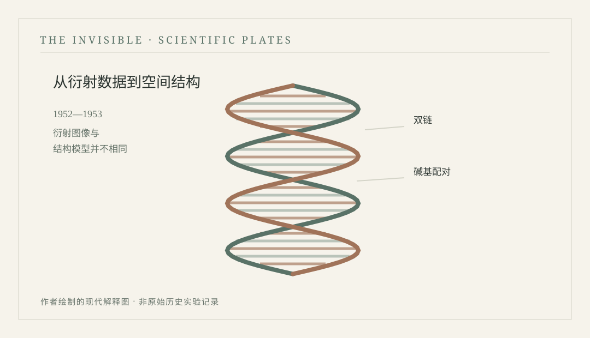

# 第二十九章　一张尚未完成的照片 {.unnumbered}

1952—1953年，英国伦敦

<!-- 公开试读第二稿；科学史书目和细节仍在审校 -->

::: {.novel-chapter}

伊芙琳在暗房里弄碎第一块玻璃底片的时候，差点把午饭也吐出来。那天早晨，她奉命清点存放影像材料的木盒，架子上有一盒旧底片因为潮气粘住，取出来时一角碰上桌边，发出轻而脆的响声。她赶紧关上门，把碎片收进专门的容器，又在记录簿上写明损坏的编号。她原以为会受到严厉责备，负责器材管理的老职员却只是让她先看清损坏的是哪一份，又核对了盒上的日期。那是一张已经完成登记的旧测试片，虽不能再用于展示，相关结果仍有记录保存。老职员叫她把事情经过写完整，随后送来新的底片继续工作。伊芙琳站在洗片水槽前，手心出了汗，直到水龙头里冰凉的水流过指尖，才慢慢缓过来。

伊芙琳二十五岁，住在伦敦南边一间与人合租的公寓里。父亲是邮局职员，母亲在一家学校食堂工作，家中还有一个正在学机械的弟弟。战争结束已经多年，城市里的许多地方仍留下修复和重建的痕迹，食品配给制度也没有完全成为过去。伊芙琳小时候喜欢照相，曾把攒下的钱交给一家街角照相馆，请师傅教她辨认底片的正反面，学会观察冲洗时间与显影温度怎样改变成像效果。后来她在学院附近找到一份与仪器和影像记录有关的技术工作，工资不多，却让她第一次能够经常接触科研设施。母亲听说女儿要在暗房里工作，最关心的却是她能不能准时下班，以及那地方的化学药水会不会弄坏衣服。

她的工作地点在伦敦国王学院的一处研究设施附近。每天清晨，她从拥挤的电车下来，沿着石板路走进大楼，先检查前一天交来的器材，再按规定准备干净的底片、登记单和包装材料。她服务的几个研究小组各有不同需要，有的人研究蛋白质，有的人关注纤维状材料，还有人正在用X射线衍射研究DNA。伊芙琳对后者所知不多，只记得研究者要求严格控制样品状态，有时还要为了得到一张清晰的衍射图像等待很长时间。她第一次听见“衍射”这个词，以为不过是某种特殊的照相方法，后来才发现，底片上的明暗斑点并不是物体像人脸那样留下的影子，而是X射线与材料内部规则排列之间相互作用形成的图样。

那个春天，研究楼里经常有人讨论DNA。伊芙琳早先听说过这种物质与遗传有关，真正开始接触相关研究材料以后，却发现不同实验室关心的问题很不一样。有的人想知道DNA怎样储存遗传信息，有的人正在研究其中各种化学组分的比例，也有人更关心分子在空间中究竟怎样排列。她一开始觉得这些问题离日常生活十分遥远，可当她看到研究者为了一张图像反复调整湿度、纤维方向和曝光条件时，又不得不承认，这些困难具体得很。装置的位置稍有偏差，拍摄便可能白费；样品中的水分不同，得到的图样也可能发生显著变化；即使图像清晰，研究者仍然需要复杂的计算，才能判断分子结构是否符合观察到的规律。

罗莎琳德·富兰克林在这座学院开展X射线衍射研究，雷蒙德·戈斯林是与她合作的博士研究生。伊芙琳不是他们研究组的一员，也没有参与关键科学推断，她只是偶尔在走廊遇见匆匆经过的研究人员，看到有人抱着装有仪器零件的木盒，或在登记单上写下取用影像材料的日期。她对富兰克林最深的印象，并非来自某次著名的讲话，而是同事们谈到那位研究者时，总会提起她对实验条件要求严格。研究中对DNA样品的含水状态作了细致区分，较高湿度条件下得到的B型图样，与较低湿度下的A型图样明显不同。伊芙琳曾把两类图像拿在手里看，觉得它们不像来自同一种材料，却不敢因此认定自己懂得其中的分子差别。

五月的一个上午，伊芙琳看见一位负责X射线设备的职员拿着长时间曝光的登记卡从走廊经过，便顺口问为什么需要占用装置这么久。对方说，有些微弱的衍射信号需要很长的曝光才能在底片上留下足够清楚的痕迹，不像普通照相那样按一下快门便完事。她听完有些吃惊，想到自己在街角照相馆学过的东西，忍不住问若是中途光线或装置发生变化，是不是整张底片都可能受到影响。职员说当然，所以更要严格记录条件。她回到工作台，把刚刚送来的材料重新分类，将几只快要用完的药剂瓶放到登记表上，免得下午有人来取时发现数量不够。

伊芙琳从来没有亲眼目睹那张后来被称作“照片51”的影像诞生的全过程。她只知道研究设施里正在进行一系列高精度的衍射实验，有些底片在曝光完成之前，连负责日常管理的人也没有机会看到。等到一张较清晰的B型DNA衍射图像出现在工作记录中，她第一次借着允许查阅的复制图像注意到中央附近交叉展开的斑点。它与普通照片相去甚远，没有线条勾勒出可辨认的分子，也没有一处标记说明哪个斑点对应哪一个原子。若是拿给外面的人看，多半会被当成拍坏了的星空，或者某个黑暗房间里被灯光照出的几道痕迹。

她把图像拿给同事朱迪思看，问是不是因为样品呈螺旋形，才会出现这样的交叉图样。朱迪思学过一些相关知识，告诉她衍射花样与分子的空间规则排列有关，具有螺旋对称性的结构确实可能产生特征性的交叉图样，但要确定详细结构仍需分析斑点位置、强度以及其他实验约束。伊芙琳听得半懂，问既然已经拍到这样的图像，为什么研究者不直接画出最终模型。朱迪思反问，若是一张建筑物的影子落在墙上，你能不能只凭影子的形状，断定里面有几层楼、每层的墙有多厚。伊芙琳想了想，承认不能。朱迪思说X射线衍射的分析比影子复杂得多，图样本身也不是建筑物在底片上的直接投影。

午饭时，两个人坐在窗边，吃从家里带来的三明治。朱迪思正在考虑申请进一步的研究训练，担心自己的数学基础不够，工作和学费又难以兼顾。伊芙琳劝她不妨先去听一门晚课，至少能够知道自己是否真的愿意继续。朱迪思说她也想过，只是家里人都希望她找到一份有稳定收入的工作，将来结婚以后不必整天在学院里奔忙。伊芙琳没有劝她为了科学牺牲一切，反而认真帮她算了一遍课程费用和晚间交通的花销。算到最后，她们发现如果每个月少买几次电影票，倒是能省出一部分钱，却仍然不够支付全部费用。两个人笑起来，又各自把便笺收好，准备下午继续工作。

那一年，富兰克林及其同事仍在分析不同状态的DNA数据。伊芙琳在走廊里听见别人讨论模型与计算，有时觉得一个研究问题竟然可以使许多聪明人采取完全不同的办法。有人相信尽可能从实验数据中推导结构最为稳妥，有人则愿意先利用已知的化学和物理约束搭建模型，再检验它是否符合各类数据。她读过一些科学报道，知道剑桥也有研究者在思考DNA结构，却不知道他们之间有多少交流与竞争。对她而言，这些人都住在火车能够到达的地方，却像属于不同世界：有的每天围着X射线装置和胶片工作，有的花更多时间摆弄模型中的球和连接杆，还有人关注化学组成和分子间距。

入秋后，伊芙琳收到一家商业摄影公司的招聘信。对方愿意提供略高一些的工资，也允许她学习彩色照相技术。母亲很高兴，觉得那份工作将来更有发展前途，况且不用天天接触学院里那些难懂的研究材料。伊芙琳自己也犹豫。研究设施里的工作稳定，却未必能有更高职位，她常觉得技术人员的劳动很容易被忽略，别人谈起一次科学发现时，记住的是某篇论文和少数研究者的名字，至于底片如何保管、仪器怎样维护、每一天的样品如何登记，往往很少有人提起。她不确定自己是否愿意继续做这些工作，便把信放在抽屉里，过了许多天也没有答复。

圣诞节前，朱迪思终于报名参加了一门晚间课程。她把缴费凭证带到食堂给伊芙琳看，神情既兴奋又有些不安，仿佛只要把那张纸弄丢，决定便可能失效。伊芙琳为她高兴，也悄悄替自己找了几本有关物理和摄影技术的入门书。她发现，自己并不是讨厌日常技术工作，而是希望有一天能够更清楚地理解这些工作与研究问题之间的关系。她开始在不影响职责的前提下向有经验的同事请教衍射图像的基本原理，慢慢学会分辨某些常见的曝光与处理缺陷。她仍然算不出DNA的空间结构，但至少知道一张清晰底片的背后，并不只有拍摄者按下开关的那个瞬间。

1953年初，DNA结构研究的消息在不同机构之间传得越来越快。后来可查的历史资料显示，莫里斯·威尔金斯曾在富兰克林不知情的情况下，将一份重要的B型DNA衍射图像展示给剑桥的詹姆斯·沃森。照片之外，来自国王学院及其他研究的实验数据，也对沃森与弗朗西斯·克里克建立双螺旋模型提供了重要约束。伊芙琳当时并不知道图像流转的完整经过，也没有机会站在剑桥的模型旁，观看那两位研究者把各项证据组合起来。她所知道的，只是研究楼里的同事开始更加频繁地谈论来自剑桥的结构模型，仿佛有人突然在一张仍未完成的地图上找到了新的路线。

那阵子，伊芙琳正在忙着准备一批需要移交的影像材料。学院内部的研究人员安排发生变化，一些记录需要按规定整理和交接。她检查了数十份表格，发现其中有几份对同一张底片使用了不同的简称，只好去找相关人员确认，避免以后查阅时误认为是两份材料。那天她工作到很晚，走出大楼时街上已经亮灯，附近一家面包店快要关门，她进去买了一块打折的面包。回到住处以后，母亲打电话问她工作是否还顺利，伊芙琳说还好，暂时不打算去那家商业公司。母亲没有立即赞同，只叫她以后记得多为自己打算，不要总替别人的工作忙个不停。

四月，关于DNA双螺旋结构的论文正式发表。伊芙琳在《自然》上看见沃森和克里克提出的模型，以及同一期中富兰克林与戈斯林、威尔金斯及其同事分别发表的实验研究。她把几篇文章的题目抄在笔记本上，发现它们虽然谈的是同一种分子，却从不同角度提供信息。结构模型清楚地展示了两条链的配对和空间安排，也提示了遗传信息复制的可能机制；衍射研究则提供了模型必须满足的实验约束。她翻到熟悉的图像，觉得自己终于知道为什么有人愿意花几十个小时只为得到一张底片，却仍然不能仅凭那张图便讲完整个故事。

<figure id="plate-29-dna" class="book-plate book-plate--diagram">

<figcaption>现代科学示意 · PLATE 09DNA双螺旋的结构性示意，不是1952年富兰克林与戈斯林获得的X射线衍射图，也不是所谓“照片51”的复制。原创矢量绘图 · 本书编辑图版</figcaption></figure>

朱迪思从晚课回来时，见她正在看期刊，便问是不是又出现了什么重大发现。伊芙琳把几篇文章摊开，指着其中一幅衍射图，告诉她这就是此前大家一直讨论的那类影像。朱迪思坐下来读了一会儿，说自己在课堂上听见了关于双螺旋模型的介绍，还听老师谈起模型和实验之间的关系。两个人讨论到夜里，发现彼此仍有许多不懂的地方，却已经不再像一年前那样，把一幅黑白斑点图当成无法解读的谜语。朱迪思忽然问，既然这么多人的工作都很重要，后来的人会不会记得每一份贡献。伊芙琳想了想，说恐怕不会全部记住，就像印在报纸上的一张照片，读者很少会知道是谁保存的底片、是谁检查的暗房温度。

这话并非出于抱怨。伊芙琳知道科学成果的署名应当反映实质贡献，日常技术支持不等于完成结构推断；同样，她也知道人们在讲述一项复杂发现时，往往容易把漫长的工作缩成某一个令人难忘的场景。她曾经弄碎过一张旧底片，也曾因为记录不清楚而在柜子前寻找半个下午，后来又学会通过相同的程序减少错误。她不愿让自己的工作被夸大成重要发现的一部分，却也不想它被简单说成毫无意义的杂务。对于她这样的人来说，能否把一份真实的记录妥善保存，已经足以决定以后的人是否还能看见那项工作曾经发生过。

春末的一天，伊芙琳收拾储存柜，发现那家商业摄影公司寄来的招聘信还压在抽屉底下，信封已经有些发皱。她把信取出来，读了读当时开出的薪水和职位要求，随后写了一封礼貌的回信，解释自己暂时仍打算留在学院。写完以后，她没有把信立即封上，而是又坐下看了一会儿窗外。伦敦的天气逐渐暖和，街上的行人脱下厚外套，一群学生在路口争论下午该去哪儿吃饭。她突然意识到，自己早已不再是刚来时那个害怕弄坏玻璃底片的新手，但也还没有想好以后究竟要成为怎样的人。

她把回信装进信封，放到准备寄出的文件里。随后，她从架子上取下一只空木盒，把新整理好的影像目录放进去。目录里有许多编号，某些照片已经被反复引用，另一些则尚未出现在正式发表的论文中。她一项项检查，确认每份材料的保存位置能够与记录对应。忙完以后，屋里只剩下几盏灯，水槽边散发着淡淡的药剂气味。伊芙琳关好柜门，拿起外套，在门口停了一下，回头望见那些整整齐齐的木盒，终于放心离开。

多年以后，照片51会一次又一次出现在书籍、课堂与博物馆的展板上。有人把它描述成一个在不同研究者之间流转的关键资料，有人把它视作天才灵感的最后一块拼图，也有人重新回到实验笔记、照片和通信资料，仔细追问研究者当时已经知道什么、还不知道什么。伊芙琳当然不会预见这些争论。她在1953年春天所面对的，不过是一批需要妥善整理的材料、尚未付清的房租，以及一份她不想轻易放弃的工作。那天晚上，电车到站以后，她顺着街道走回家，手里提着一袋从市场买来的土豆，想着明天早晨记得把借来的物理书还给朱迪思。

:::

---

::: {.history-note}
## 真实历史与科学解读 {.unnumbered}

1952年5月，罗莎琳德·富兰克林与研究生雷蒙德·戈斯林在伦敦国王学院获得著名的DNA B型X射线衍射图像“照片51”；这不是直接拍到的双螺旋照片。1953年4月25日，《自然》同期发表沃森与克里克的DNA结构模型论文，以及富兰克林与戈斯林、威尔金斯及同事的相关论文。2026年10月发表于《科学史与生物学史杂志》（Journal of the History of Biology）的一项档案研究进一步指出，富兰克林已从较早的“照片49”提取了重要结构信息，“照片51”是有计划取得的改进图像；不能把她写成没有意识到衍射图像价值的人。威尔金斯在富兰克林不知情时向沃森展示了照片51，此举涉及科学史上的资料交流和贡献认定争议。伊芙琳、朱迪思及其私人生活、暗房工作和对话均属虚构，不能据此认定真实实验室存在这两位工作人员。

:::
