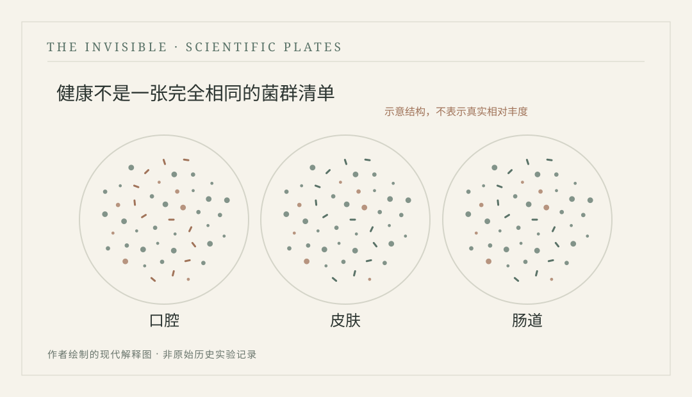

# 第三十五章　人体地图 {.unnumbered}

2012年，美国东海岸

<!-- 公开试读第二稿；科学史书目和细节仍在审校 -->

::: {.novel-chapter}

海伦的办公桌上堆着三种颜色的文件夹，蓝色的是等待核对的知情同意材料，灰色的是样本采集记录，白色的则是需要重新联系的受试者。她刚来这家研究机构时，认为自己的工作无非是安排时间、接电话和把表格归档。半年以后，她才知道，一项研究若要连续采集不同身体部位的微生物样本，需要解决的麻烦远超想象。有人临时改了预约日期，有人按照要求采样却忘记在容器上贴编码，还有人担心自己的身体资料会被公开，反复询问究竟谁能够看到相关信息。

海伦三十七岁，原本在医院行政部门工作，后来转到研究协调岗位。她不擅长谈论基因，也没兴趣与实验室人员争论不同测序平台的优缺点，但很在意每位参加研究的人是否理解自己签署了什么。有一次，一位受试者带着两页打印出来的网络文章来到办公室，问研究者是不是能从皮肤和肠道样本里判断自己有没有癌症。海伦没有随意安慰，便请负责研究的医生说明当前项目的目标和局限。医生解释，这项工作是在描绘健康成人不同身体部位的微生物群落特征，并不是向每个受试者提供针对特定疾病的临床诊断。那人听完有些失望，却仍决定继续参加研究。

她还记得自己第一次向人解释样本用途时，面对的是一个刚从外地搬来的年轻人。他以为参与项目就能得到针对个人的健康评估，问采集结果能不能告诉他该换哪种牙膏、该不该吃某种食品。海伦当时几乎照着说明书逐字朗读，越念越像是在拒绝回答。后来她学会先请对方说清想知道什么，再解释研究能够做什么、不能做什么，以及哪些结果不会像临床检查那样反馈给个人。她也学会接受有人听完便决定不参加，不再把这种决定视为自己工作失败。

有一天上午，海伦需要为一位参与者重新安排全部采样。对方临时服用了一种药物，研究方案要求记录并评估这类情况，但最初的预约系统只留下一个简单的勾选框。海伦电话里反复确认，最后决定先请临床协调员审核，再重新约时间。挂断以后，她在表格背面写下当天经过，给下一位接手的人留足解释。她不愿把一次小小的改期变成研究员日后无法理解的数据异常。

当时，人体微生物组计划已经开展多年。不同机构的研究者试图以相对统一的流程收集、测量和分析人体多个部位的微生物群落。海伦每天面对的是具体的个人和样本容器，数据分析团队面对的却是越来越庞大的序列集合。两边常常因为一处字段的命名争论半天。有次实验室要求她说明某个样本为什么没有按照原定时间送达，她翻查记录，发现当天医院停车场施工，运送车辆被堵在了另一处入口。对分析人员来说，那可能只是一项批次信息；对海伦来说，却意味着三个人在雨里推着转运箱绕了半栋楼。

有一次，两个实验室对同一种采样容器给出了不同的使用说明。研究护士已经按第一套流程完成准备，技术人员却要求重新采集，双方在电话里都觉得自己遵守了规定。海伦拿出统一的操作手册和当时留下的版本号，发现一方使用的文件尚未更新。她组织一次简短会议，把修改日期、责任人和材料接收方式写得明明白白，还要求每个中心确认已经收到相同版本。当天晚些时候，一位参与者问为什么研究要如此麻烦，她想了想，说样本离开人体以后仍然会经历很多步骤，不能让不同的人凭记忆各做各的。

项目逐渐有了更多结果。来自皮肤、口腔、肠道和其他身体部位的样本，展现出明显不同的微生物生态特征。研究者惊讶地发现，即便是经过严格筛选、符合研究健康标准的参与者，他们之间的群落组成也不完全相同。海伦把一份科普说明稿递给同事修改，原稿中写着“为每个人绘制正常菌群模板”。她觉得这句话容易让人误解，便在旁边标注：如果健康人之间本来就有广泛差异，为什么一定要有一张人人都应当符合的模板？

那年春天，研究小组举行了一次内部开放日，邀请参与项目的行政人员参观数据分析设施。海伦第一次走进平时很少去的服务器机房，看见整排设备发出持续的低鸣。研究人员向她展示从样本编号到序列读取、再到微生物分类特征的处理过程。屏幕里有成千上万个数字，她费了很大力气才找到自己前几天核对过的一个样本编码。原来那只普通塑料管如今已经变成数据表里的一行，后面附着许多微生物名称和丰度。她不知道这些数字是否准确反映了样本的每一处细节，却清楚知道，倘若当初编号贴错，后面所有计算都可能归到错误的人身上。

<figure id="plate-35-niches" class="book-plate book-plate--diagram">

<figcaption>现代科学示意 · PLATE 10人体不同部位微生物组的示意图。符号只用于表现不同生态位及个体差异，不代表任何真实研究中的物种丰度数据。原创矢量绘图 · 本书编辑图版</figcaption></figure>

项目扩大以后，研究中心从不同城市收到一批批样本。有些箱子在指定时间抵达，有些遇到航班延误，工作人员得按流程检查温度记录与包装状态。海伦看见一位同事因为一条未签名的交接记录被要求重查，起初也觉得繁琐。等到一批样本的序列结果与预期差别很大时，她才明白，只有把采样之后发生的事情记录清楚，研究者才有机会判断差别来自生物学，还是来自运输和处理。

午餐时，一位年轻统计学家问她是否觉得研究过分依赖文书工作。海伦想了想，说自己也曾抱怨表格太多，可假如一个人连样本究竟属于哪个部位、来自什么时间都无法确认，再先进的分析也不会自动知道事实。统计学家笑着承认这话有理，随后讲起他们正在建立的质量控制流程。海伦听到一半便跟不上复杂术语，却认真记下了几个直接影响采样协调的问题。下午回到办公室，她把原有工作表重新整理，减少了重复填写的字段，也增加了必要的核对环节。

研究中心里另一位负责信息安全的同事提醒海伦，样本编号虽然不直接写着姓名，某些采样时间与其他背景信息组合起来，仍可能带来识别风险。海伦于是参加了专门的数据管理培训，学会区分用于联络随访的身份信息、实验室需要的样本编号和公开资源中可以使用的研究数据。她的办公桌上多了一只上锁的柜子，常用的临床联系表也不再与测序结果放在同一个共享目录。她并非因此对研究失去热情，只是知道每一个愿意提供样本的人，都有理由问研究者将怎样保管它。

六月，一批人体微生物组的重要成果正式发表。团队成员们在会议室里看期刊封面，年轻研究者相互拍照，忙碌多时的气氛终于轻松下来。海伦照常坐在前排，手里拿着下周的预约单。有人邀请她站进合影，她开始推辞，说自己又没做测序，后来被同事拉到中间，站在一位实验室技术员旁边。拍照时有人忽然喊，大家把胸前挂着的工作证摘掉，不要让相机照进个人编号。众人笑着取下证件，又重新站好。

在接下来的几周，媒体对研究成果产生了浓厚兴趣。有些报道将其称作人体的另一张地图，也有标题说研究者终于找到了健康人的微生物标准。海伦把这些报道发给研究医生，请对方准备一份常见问题说明。她知道受试者很快会打电话来问，自己的结果究竟属于哪种类型。果然，第一通电话在第二天早晨便打来。对方是位退休教师，想知道自己和其他人有何不同，是否需要购买某种补充剂。海伦按照约定解释研究不提供这样的个人诊断或治疗建议，并主动联系临床团队回答对方关于健康管理的一般疑问。

在那场临时的媒体说明讨论中，海伦建议将“正常人体微生物组”改成“依据本项目入选标准观察到的健康成人微生物群落”。宣传同事担心标题变长，读者不愿看；统计学家则提醒，他们招募的是经过筛选的人群，不能仅凭当前研究代表全球所有年龄、环境和疾病背景。几个人最后没有把全部限定条件塞进标题，却在正文第一段保留了研究对象与样本来源。海伦只要求再多加一句话：这并不是一种人人都必须符合的健康标准。

一次参与者交流会上，一位受邀旁听的退休教师问，既然项目会公布各身体部位的微生物图谱，自己是否能在网站上认出某位熟人的数据。研究员解释研究结果以适当方式汇总、数据访问需要遵循管理规定，但这种说法仍让对方有些担忧。海伦没有催他签字，只把知情同意中有关个人信息和样本使用的段落指给他看，让他带回家认真考虑。第二周，那位教师才决定参加。他告诉海伦，自己最在意的不是别人能否从研究中获益，而是有人是否愿意认真回答他的问题。

有一位三十多岁的研究参与者每次来都带着一只小笔记本。他会把前一天吃过的东西、最近的睡眠和感到不舒服的地方记下来，生怕自己遗漏了研究团队需要的信息。海伦向他解释，哪些资料属于研究方案规定的采集范围，哪些不需要勉强补充，并提醒他不应为了参加研究而改变正常生活。老人听完仍然认真做记录，后来却开始在旁边写一些自己的小事，比如周末看过的电影和孙女的考试。海伦发现这些与研究无关的内容，便没有复制进数据库，只在见面时笑着问了两句。

一次样本转运延误后，海伦需要决定哪些材料应标记为超出预定处理时间。实验室的同事建议把那些样本暂时放在一边，等后续评估；另一个项目成员却担心数据量减少，提出能不能先照常纳入分析。海伦把实际时间记录拿出来，坚持不能把四十分钟写成二十分钟。讨论最终回到质量控制标准本身，团队决定保留原始信息，再由预先明确的规则判断是否使用。那天她下班很晚，丈夫来接她时问是不是又有人把表填错了，她说这次不是填错，是大家都希望数据尽量完整，却忘了完整不一定等于可靠。

临近下班，那位负责接收样本的同事来找她，说仓库里有几只标签颜色相近的箱子，稍不注意就可能放错架。海伦与他重新规划货架，按实际样本类型和处理阶段分区，并把临时存放的记录贴到醒目的位置。事情做完以后，办公室窗外已经完全黑了，她在回家电车上想起女儿答应要带去学校的手工作业还没完成，便赶紧发信息让丈夫先找出剪刀和胶水。女儿回了一个皱眉的表情，问今晚能不能不谈微生物。海伦看着屏幕笑起来，说回家以后先把那只纸灯笼做好。

成果发表以后，海伦收到一张没有署名的感谢卡。卡片上只写着几句简单的话，说自己作为研究参与者，很高兴有人认真解释过那些采样要求，也愿意相信样本会被妥善处理。她无法判断是谁寄来的，便把卡片夹进工作日志。很多年以后，她或许不记得某份样本的具体编码，却仍会记得这些陌生人怎样把自己的时间和身体资料交给一项尚未知道全部结果的研究。

研究中心召开阶段总结会时，海伦没有坐在主桌。她站在门边，手里拿着当天需要签收的资料清单，听学者们讨论新数据能否反映健康人群的广泛多样性。有人说数据规模令人振奋，她想到的却是不同诊室里反复确认采样要求的人，以及那位曾因担心隐私而犹豫的退休教师。她知道自己没有参与推导理论，却也知道若少了那些具体的核对工作，漂亮的图谱便没有可以信赖的起点。

夏天结束时，海伦换了一个新的文件柜，原来塞得满满当当的蓝色文件夹终于有地方放了。她给柜门贴上编号，锁好钥匙，准备离开办公室。手机里有丈夫发来的消息，问她是否还能赶上女儿的学校演出。海伦看了看表，收好最后一份记录，快步走向停车场。演出开始时她刚好赶到，女儿穿着浅绿色裙子站在舞台边，看见母亲后偷偷挥了挥手。海伦坐下，发现自己整整一天都在处理别人的样本和资料，此刻终于有时间认真看一看自己的孩子。

:::

---

::: {.history-note}
## 真实历史与科学解读 {.unnumbered}

美国国立卫生研究院支持的人体微生物组计划2007年启动，2012年在《自然》等期刊发表重要成果，系统展示健康成人不同身体部位的微生物群落特征与个体差异。海伦、受试者对话和研究机构日常情节均为虚构；相关故事不能理解为真实项目参与者的隐私记录。

:::
