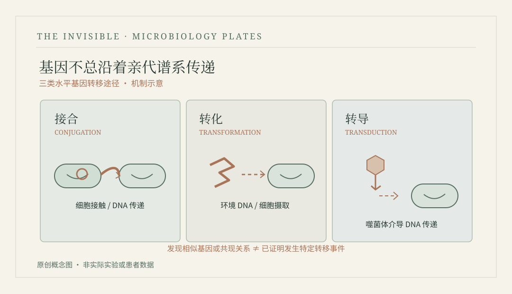

# 第四十二章　借来的基因 {.unnumbered}

2026年，中国南方

::: {.novel-chapter}

周宁收到那批细菌分离株的测序结果时，刚刚结束夜班。检验科的走廊里还亮着灯，清洁人员正在擦地，门口的转运箱堆着当天清晨送来的样本。她把白大褂挂回柜子，原本准备去休息室喝杯热水，却看见同事在电脑前招手，说有两株来自不同时间和不同患者的细菌携带相似的耐药相关基因。年轻同事已经画好一张连接图，几条粗线从不同样本指向同一个基因名称，图上看起来像是发生过一次清晰的传播。周宁没有立即赞成，只让他把分离株鉴定、药敏结果和采样来源先整理出来。

周宁三十五岁，在医院临床微生物检验部门工作多年，习惯了每天与数字和真实病人同时打交道。她知道某些耐药菌感染可能使医生的治疗选择变得困难，也知道一个漂亮的基因组分析结果不能替代临床病程和感染防控调查。病人住在哪个病区、样本是什么时候采集、是否属于定植而非感染，以及在何种情况下使用过抗菌药物，都会影响最终解释。她从不觉得基因测序不重要，却对那些没有核实基本信息便急着画传播路径的人缺乏耐心。

这次合作研究还涉及程屿的团队。杜然希望利用现有宏基因组数据探索移动遗传元件与菌株功能差异，得知医院得到一组耐药菌分离株序列，便主动提出能否参与分析。周宁答应先召开会议，前提是所有临床材料必须经过相应审批和去标识化处理，不能把患者身份、详细住址或不必要的个人信息带进研究数据库。杜然说自己明白，又补充最近已建立了一套检查序列上下文和覆盖质量的流程，比几个月前那种直接构建大网络的做法谨慎许多。

周宁把两份分离株报告摊在桌上，让年轻同事指出究竟哪一处证明发生了患者间的直接传播。对方指着相同的耐药基因和一段高度相似的序列，周宁又问采样时间、病区接触史、细菌的整体基因组关系是否支持同一条路径。对方翻了很久，最后承认还缺少几项关键信息。周宁没有否定他的努力，只请他把‘证据已经支持’与‘尚待排查’分别标记。实验室外有人推着标本车走过，车轮的声响使两个人停顿片刻，然后继续核对。

<figure id="plate-42-hgt" class="book-plate book-plate--diagram">

<figcaption>现代科学示意 · PLATE 12细菌水平基因转移的接合、转化和转导三种机制示意。检测到同源基因或相关性，不能单独证明某次转移实际发生。本书原创矢量图 · 现代科学解释用图</figcaption></figure>

会议上，感染科医生先介绍临床背景。部分患者确实存在需要积极处理的感染，而另一些样本反映的是筛查或定植情况，不能把所有分离阳性的结果混在一起统计。周宁随后展示药敏和分离株鉴定信息，强调基因存在与实际药物敏感性之间的关系需要结合具体机制和实验室证据判断。杜然打开基因组比较图，指出某些耐药相关序列具有相似的周边结构，但仍可能来自已经广泛传播的遗传元件，不能据此证明它们在这几位患者体内直接交换。

讨论到一半，一位行政协调员来问能否尽快写出“院内交叉传播链”的初步结论。周宁听完，耐心解释目前资料不足以支撑如此明确的判断，感染防控需要根据实际病例、时空接触信息和其他微生物学证据综合分析，必要时还要继续采样。协调员说上级部门希望早点有答案，周宁回答她理解这个要求，但过早认定错误的传播路径，可能使人们把注意力放在不该关注的环节上，反而影响真正的防控工作。

协调员走后，周宁没有让所有人等到基因组分析结束才行动。她与感染防控人员先把已经得到的培养、药敏和病区资料分开整理，请临床团队按既有规范评估是否需要加强监测、复核接触史与环境清洁记录。这样的工作看起来不如一张传播网络引人注目，却不依赖他们尚未证实的箭头。她特别要求，把研究人员提出的传播假设与正式的临床防控判断用不同标题保存，免得下一班接手的同事把一种推测误当成已经确定的结论。

那周的交班会上，年轻检验人员带来一张重新整理的时间表。他把“样本送达”“首次培养阳性”“测序报告出具”分成了三列，又为信息尚未核实的条目留了空白。有人嫌空白太多，问能不能先按推测补齐，周宁说记录里留着空白，至少能提醒后来的人去找依据；填上一个看似合理却未经确认的日期，错误便可能沿着后续每一次分析传下去。同事们于是决定从原始条码、检验系统与病区记录分别核对，而不是让一份整理表替代所有来源。

几天后，他们向负责会议汇报的协调员交出两份不同用途的材料。一份只列已经核实的事实和需要采取的常规管理措施；另一份列出研究性假设、证据缺口及下一步取样计划。协调员最初不满意，说这样看不出一个清楚的故事，后来接到一通询问具体防控安排的电话，才发现前一份材料反而更容易回答问题。周宁没有因此觉得争论胜利了。她把其中几项仍未补全的资料交给下一班人员，自己去食堂买了一碗热粥，吃完才回办公室继续处理未完成的检查。

调查进行到第三周时，周宁发现两份实验记录对同一个分离株的培养日期写法不同。她没有立即判断是严重错误，先叫来负责接样的同事，一起回查机器日志与条码扫描时间。结果发现一份表写的是样本接收日，另一份则是菌落分离完成日，原本指的便是不同事件。年轻同事松了口气，周宁却说这正说明必须把时间变量的含义写清楚，否则以后有人根据这些日期重建传播路径，很容易出现完全不必要的偏差。

临床医生在讨论会上提醒，治疗决策不能只依赖某个耐药基因的名称，还需要结合培养、药敏实验以及具体病人的情况。周宁听见这句话，想起自己刚参加工作时，总觉得一份序列报告会比繁琐的实验更接近答案。如今她知道这些技术不是互相争夺胜负的对手：基因组帮助追踪潜在来源，常规检测帮助医生判断眼前的药物选择，流行病学调查则必须弄清病例之间是否真的存在接触。会议结束时，各项工作被分给不同岗位，没有一个人能够替其他人全部完成。

那天晚上她同女儿一起做学校作业，发现孩子把几片不同颜色的纸剪成细条，在桌上编出一张很复杂的网。女儿说这代表全班同学谁借过谁的书，线越多关系越密。周宁问她是不是每条线都能证明两个人见过面，女儿说不一定，有时一本书是别人转交的。周宁觉得这个解释很有意思，便帮她把“直接借书”和“间接转交”用不同线条标清。孩子嫌颜色不够漂亮，最后又加了一圈浅蓝色边框。

医院完成阶段性讨论后，周宁给研究团队写了一封邮件，提醒所有微生物遗传分析都应同感染防控工作的实际问题分开呈现。她在最后附上几条自己最关心的临床信息缺失项，希望未来前瞻性研究能够预先明确采样与记录规范。杜然回复说这些问题对算法也很重要，愿意把相关标准加入研究计划。周宁关上邮箱，走进实验室准备次日工作，发现新到的一批培养皿还放在转运台上，便先让同事核对样本数量，再开始后续操作。

晚上，周宁回家发现女儿还没睡，正把学校里做的一张家庭树图贴在墙上。图中祖父母、父母与孩子之间用线连接，旁边贴着不同颜色的照片。女儿问妈妈，为什么老师说每个人都可以从家人那里得到遗传信息，却又会与父母不完全相同。周宁用孩子能够理解的话解释了一些基本遗传概念，随后提醒她，微生物中的遗传关系还有其他复杂情形，不能把人类家谱直接搬到细菌上。女儿并不关心细菌，她只想确认自己贴错的一张照片是否应该移到另一边。周宁帮她重新粘好，才去厨房热晚饭。

那天下午，一名年轻检验人员因为接连两次样本编号问题受到批评。周宁让她坐下，把两次情况分别写在纸上，发现并非简单的粗心：第二次送检单上的编号格式与第一批并不一致，转录时容易漏掉中间的一位数字。她向科室提出统一核对流程，决定暂时不在报告里使用可能存在混淆的关联结果。年轻人问这会不会让研究进度变慢，她说会，但那总比把两名不同患者的资料误认为同一个人强。

第二天，杜然发现一处自己原先忽视的事实：两段看似相同的候选耐药区域位于不同的组装背景，其中一份序列的边界并不完整。原先清晰的连接关系由此变得不确定。他把情况告诉周宁，担心前两天做的图都得推倒重来。周宁说图可以重画，关键是问题要记下来。她又把一批新的分离株质量报告发给他，让他先核查完整性，再讨论是否可能存在共同来源或移动遗传元件传播。

这项调查最后没有得出一条可以简单画成箭头的直接传播链。研究人员确认了若干值得关注的耐药遗传特征，也明确了哪些证据仍然不足。感染防控团队继续按照医院规范开展监测与管理，临床医生则根据具体患者的病情和实验室证据调整治疗。杜然在汇报里把“证明基因转移”改成了“获得候选遗传元件关联线索”，一开始觉得不够有力，后来听见周宁介绍某位患者经过治疗情况好转，又觉得那张图是否复杂，似乎没那么重要。

傍晚查房的消息传来，前几天令团队担忧的一名患者病情有所好转。周宁没有参与治疗，只在检验科里听医生介绍情况。她走到窗边，看着不远处门诊楼里的灯逐渐亮起，忽然觉得自己争论了几天的箭头并非没有意义，只是它们不应该替代那些已经能够帮助患者的稳妥工作。电脑里仍留着数个尚不能排除的遗传交换假说，她把它们逐一标成待查，不再急着让网络看起来首尾相连。

会议结束后，程屿跟周宁一起走过医院门诊大厅。大厅里有人推着轮椅，有人抱着孩子，也有人拿着检查单站在收费窗口前等待。周宁说自己并不反对研究者寻找新的机制，只是每天面对具体病例，会更加清楚哪些结论能用于行动、哪些暂时还不能。程屿看见她手机里跳出一条值班通知，便没有继续占用时间。两人在电梯口分别，周宁回检验科，程屿则带着修订后的分析计划回学校。走到门口时，他发现天色有些阴，便从包里取出一把折伞。

:::

---

::: {.history-note}
## 真实历史与科学解读 {.unnumbered}

细菌可通过接合、转化、转导等多种机制交换遗传信息，移动遗传元件可参与抗菌药物耐药相关基因的传播。但“不同样本携带相似基因”不等于已经证明样本之间发生直接转移，更不能直接等同于医院内的患者传播路径。本章医院、病例及人物全部虚构，不构成实际感染防控或治疗建议。

:::
