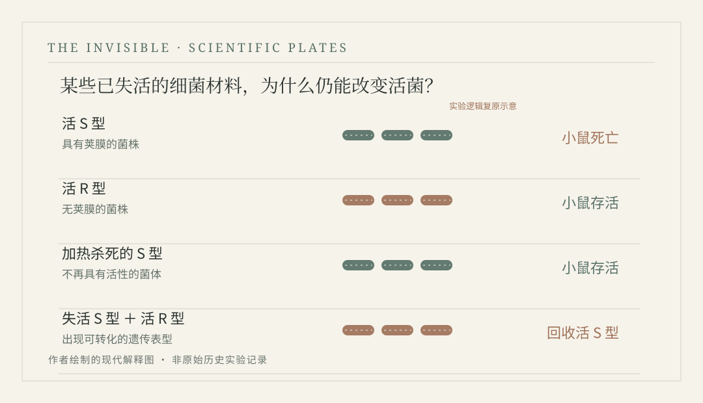
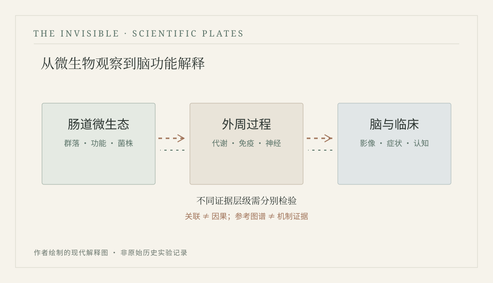

<header class="editorial-page-head">
THE SCIENTIFIC PLATES
<h1>看得见的证据</h1>
十二幅精选图版，沿着小说故事的场景展开。历史原图与现代科学示意明确分开，图注给出出处和证据边界。点击图版可返回其所在章节。
</header>

<strong>06</strong>历史图版 / 后世历史绘画

<strong>06</strong>原创科学示意

<strong>12</strong>幅正文图版

<a class="figure-gallery-item" href="chapters/volume-01/chapter-01.html#plate-01-mould">

PLATE 01 · 第1章<h3>书皮上的霉菌</h3>
《显微图谱》图版XII上部；与第一章的羊皮书皮观察相呼应。
Robert Hooke · Public Domain
</a>
<a class="figure-gallery-item" href="chapters/volume-01/chapter-01.html#plate-01-flea">

PLATE 02 · 第1章<h3>跳蚤的另一副面孔</h3>
展示放大后足部与身体结构；数字图像来自 Wellcome Collection。
Wellcome Collection · CC BY 4.0
</a>
<a class="figure-gallery-item" href="chapters/volume-01/chapter-02.html#plate-02-microscope">

PLATE 03 · 第2章<h3>列文虎克式显微镜</h3>
贝克1753年绘图；不能误认为1676年观察现场照片。
Henry Baker · Public Domain
</a>
<a class="figure-gallery-item" href="chapters/volume-01/chapter-07.html#plate-07-jenner">

PLATE 04 · 第7章<h3>詹纳与第一次牛痘接种</h3>
埃内斯特·博德追溯1796年事件的绘画，不是事件发生当日的画面。
Ernest Board / Wellcome · CC BY 4.0
</a>
<a class="figure-gallery-item" href="chapters/volume-02/chapter-11.html#plate-11-snow">

PLATE 05 · 第11章<h3>布罗德街的地图</h3>
1854年疫情调查的历史地图，经典图版发表于1855年。
John Snow · Public Domain
</a>
<a class="figure-gallery-item" href="chapters/volume-02/chapter-14.html#plate-14-pasteur">

PLATE 06 · 第14章<h3>鹅颈瓶与空气</h3>
反映空气与颗粒污染的区别，并非巴斯德的原始实验绘图。
本书原创矢量图
</a>
<a class="figure-gallery-item" href="chapters/volume-03/chapter-19.html#plate-19-wu">

PLATE 07 · 第19章<h3>伍连德的时代</h3>
美国国会图书馆贝恩新闻资料中的伍连德肖像，非小说现场照片。
Bain / Library of Congress · PD-US
</a>
<a class="figure-gallery-item" href="chapters/volume-04/chapter-25.html#plate-25-griffith">

PLATE 08 · 第25章<h3>死去的细菌</h3>
四组对照展示细菌转化观察，并不把DNA机制提前写进1928年。
本书原创矢量图
</a>
<a class="figure-gallery-item" href="chapters/volume-04/chapter-29.html#plate-29-dna">

PLATE 09 · 第29章<h3>双螺旋</h3>
结构模型不等于“照片51”的原始X射线衍射图。
本书原创矢量图
</a>
<a class="figure-gallery-item" href="chapters/volume-05/chapter-35.html#plate-35-niches">

PLATE 10 · 第35章<h3>人体中的不同生态位</h3>
示意口腔、皮肤、肠道群落的不同；点状符号不表示测序丰度。
本书原创矢量图
</a>
<a class="figure-gallery-item" href="chapters/volume-06/chapter-41.html#plate-41-gut-brain">

PLATE 11 · 第41章<h3>肠与脑之间</h3>
区分微生物组、外周过程和脑功能的证据层级。
本书原创矢量图
</a>
<a class="figure-gallery-item" href="chapters/volume-06/chapter-42.html#plate-42-hgt">

PLATE 12 · 第42章<h3>借来的基因</h3>
接合、转化、转导是不同机制；基因共现不能直接证明实际转移。
本书原创矢量图
</a>

<section class="figure-gallery-method">
HOW TO READ THESE IMAGES
<h2>怎样阅读这些图像</h2>
历史照片、铜版图及后世绘画可能来自不同年代，不能全部当作小说事件的现场证据；现代科学示意只用于解释机制与概念，不是新的实验数据。每幅图在正文中都有完整图注和出处。
<a class="editorial-text-link" href="appendices/plates.html">查看全部来源与使用说明 ↗</a></section>

