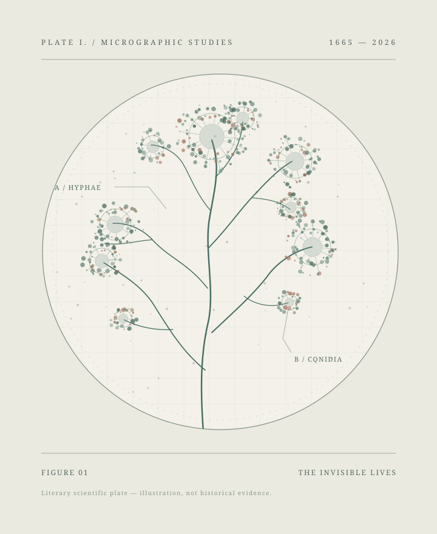

<section class="ic-hero" aria-label="作品封面">
 

  
<i></i> A SCIENCE-HISTORY NOVEL2026 / EDITORIAL EDITION

  
跨越三个多世纪的科学与人类故事

  <h1 class="ic-hero__title">看不见的 文明</h1>
  
微生物与人类的三百年

  

  
人类用了几百年才知道， 那些看不见的生命，始终与我们共同生活。

  
从显微镜里的第一滴水，到霍乱街区、战争年代的实验室，再到基因组与脑肠轴研究。这是一部关于发现、误解、抗争与理解的长篇小说。

  
<a class="ic-button ic-button--primary" href="chapters/volume-01/chapter-01.html">开始阅读↗</a><a class="ic-button ic-button--secondary" href="contents.html">查看全书目录→</a>

  
一心问道 · 著六卷 · 四十八章

 

 <figure class="ic-hero__figure"><figcaption>原创科学线描 · 非历史原图 PLATE NO. 001</figcaption></figure>
</section>

<strong>06</strong><small>VOLUMES / 卷</small><strong>48</strong><small>CHAPTERS / 章</small><strong>1665—2026</strong><small>ACROSS THE CENTURIES</small>
一部持续修订的科学历史小说 ↘

YOUR READING JOURNEY<h2>从上一次停下的地方继续</h2>
重新进入书中的那个世界。

<a id="resume-link" class="ic-text-link" href="chapters/volume-01/chapter-01.html">继续阅读 ↗</a>

<section class="ic-section ic-manifesto" id="about-the-book">
01 / THE STORY<i></i>

<h2>我们所居住的世界， 从不只有人类。</h2>

本书不是六位科学家的传记，也不是一本按年份编排的微生物学教材。历史上的重要发现，与那些没有留下名字的普通人，共同构成了故事。

伦敦书铺的学徒、经历霍乱的母女、东北防疫的护士、研究DNA的实验人员，与现代研究者程屿的困惑相互映照：我们究竟看见了什么？又凭什么相信自己已经理解？
<a class="ic-text-link" href="about.html">关于作品与作者 ↗</a>

</section>

<section class="ic-section ic-volumes" id="volumes">

02 / THE SIX VOLUMES<h2>六卷，一部不断展开的历史。</h2>
<a class="ic-text-link" href="contents.html">全部48章 ↗</a>

<a class="ic-volume" href="volumes/volume-01.html" aria-label="进入第1卷未知的生命">
  
01 <small>/ 06</small>1665 — 1796

  <h3>未知的生命</h3>
THE FIRST SIGHT

显微镜、发酵与未知的生命

  
8 CHAPTERS↗
</a>
<a class="ic-volume" href="volumes/volume-02.html" aria-label="进入第2卷疾病与城市">
  
02 <small>/ 06</small>1832 — 1867

  <h3>疾病与城市</h3>
THE CITY & DISEASE

霍乱、水井与城市秩序

  
8 CHAPTERS↗
</a>
<a class="ic-volume" href="volumes/volume-03.html" aria-label="进入第3卷医学与战争">
  
03 <small>/ 06</small>1882 — 1945

  <h3>医学与战争</h3>
MEDICINE & WAR

鼠疫、抗生素与战争年代

  
8 CHAPTERS↗
</a>
<a class="ic-volume" href="volumes/volume-04.html" aria-label="进入第4卷生命的密码">
  
04 <small>/ 06</small>1928 — 1990

  <h3>生命的密码</h3>
THE CODE OF LIFE

DNA、细菌遗传与古菌

  
8 CHAPTERS↗
</a>
<a class="ic-volume" href="volumes/volume-05.html" aria-label="进入第5卷人体的另一半">
  
05 <small>/ 06</small>1995 — 2019

  <h3>人体的另一半</h3>
THE OTHER HALF

人体微生物组与生态健康

  
8 CHAPTERS↗
</a>
<a class="ic-volume" href="volumes/volume-06.html" aria-label="进入第6卷生命的新边界">
  
06 <small>/ 06</small>2004 — 2026

  <h3>生命的新边界</h3>
NEW FRONTIERS

脑肠轴、人工智能与伦理

  
8 CHAPTERS↗
</a>

</section>

<section class="ic-breath">
FROM THE PAGES
“

我们能看见的， 永远只是世界的一部分。
作品主题引语 · 非历史人物原话
</section>

<section class="ic-section ic-selected">

03 / WHERE TO BEGIN<h2>从一章故事开始。</h2>

四个不同年代，四种观看生命的方式。

<a class="ic-pick" href="chapters/volume-01/chapter-01.html"><b>01</b>EDITOR'S SELECTION<h3>纸上的霉</h3>
一张霉菌图改变了少年理解世界的方式。

1665 · 伦敦↗
</a>
<a class="ic-pick" href="chapters/volume-02/chapter-11.html"><b>11</b>EDITOR'S SELECTION<h3>布罗德街</h3>
当疾病进入城市，一口水井承载了太多人的命运。

1854 · 伦敦↗
</a>
<a class="ic-pick" href="chapters/volume-03/chapter-22.html"><b>22</b>EDITOR'S SELECTION<h3>长霉的培养皿</h3>
一次不寻常的实验观察，距离救治病人仍有漫长道路。

1928 · 伦敦↗
</a>
<a class="ic-pick" href="chapters/volume-06/chapter-48.html"><b>48</b>EDITOR'S SELECTION<h3>看不见的文明</h3>
科学仍有未完成的问题，生活也仍将继续。

2026 · 中国南方↗
</a>
</section>

<section class="ic-section ic-time">

04 / A HISTORY IN FRAGMENTS<h2>三百余年的时间刻度。</h2>
<a class="ic-text-link" href="timeline.html">完整科学史年表 ↗</a>

<b>1665</b>显微镜

<b>1854</b>霍乱与城市

<b>1928</b>青霉素

<b>1953</b>DNA结构

<b>2012</b>微生物组

<b>2026</b>当代故事

</section>

<section class="ic-section ic-principles">

05 / HOW TO READ<h2>小说，也是一次科学史旅行。</h2>

<article>01<h3>故事先于解释</h3>
每一章都有自己的场景、人物和冲突。科学发现进入生活，而不是代替故事。
</article><article>02<h3>史实与虚构分明</h3>
章末附“真实历史与科学解读”，说明事实依据和虚构情节，避免把想象当作史料。
</article><article>03<h3>持续公开修订</h3>
正在公开的是文学统稿，后续将在保留章节历史的基础上继续完善科学和文学细节。
</article>
</section>

<section class="ic-author">
THE AUTHOR<h2>一心问道</h2>
华南理工大学博士在读，关注微生物组、脑科学与智能生物解析。这本书源于对微生物科学史与普通人命运的共同兴趣。

<a class="ic-text-link" href="about.html">读一读作者的话 ↗</a></section>

<section class="ic-finale">
INVITATION TO READ VOLUME I — VI
<h2>从一滴水开始， 走进另一个世界。</h2>
六卷 · 四十八章 · 全文开放阅读
<a class="ic-button ic-button--light" href="chapters/volume-01/chapter-01.html">翻开第一章↗</a></section>

<footer class="ic-home-footer">© 2026 一心问道 · 保留所有权利
<a href="download.html">下载与版本</a><a href="appendices/references.html">参考资料</a><a href="https://github.com/zbyloveyj/invisible-civilization">GitHub ↗</a>
</footer>

